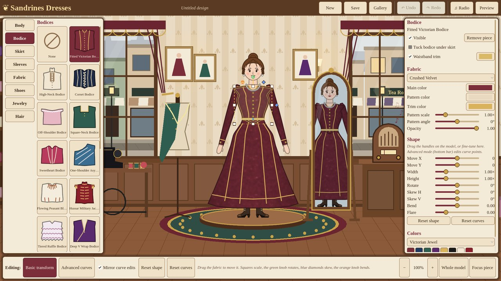
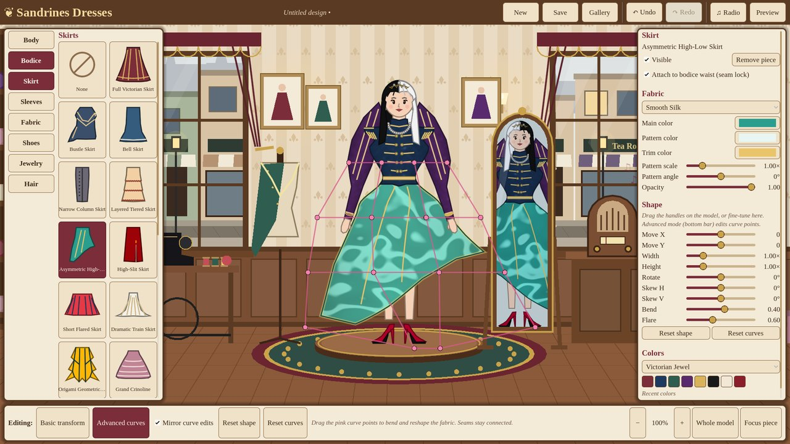
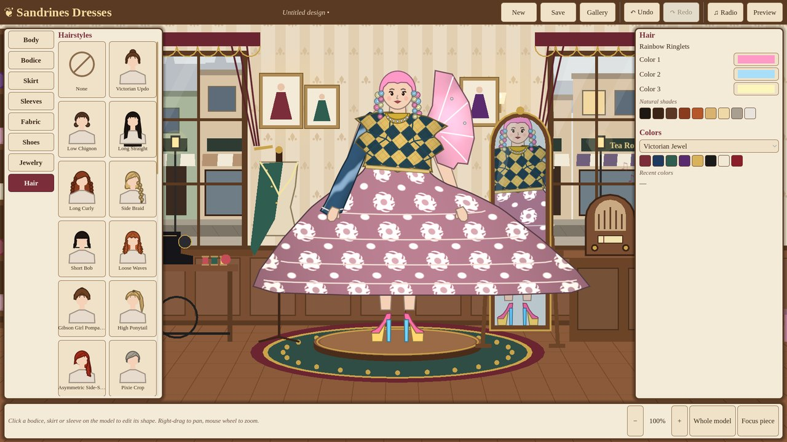
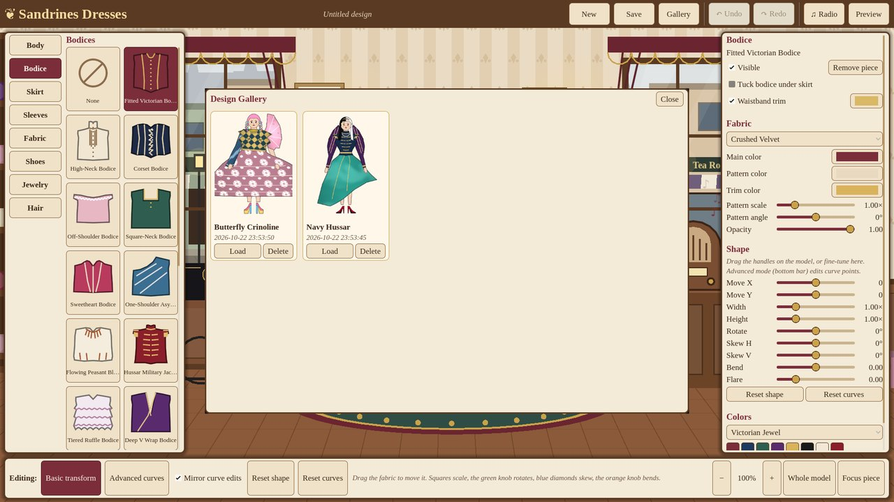

# Sandrines Dresses

A relaxing dress-designing sandbox set in a Victorian British dressmaking boutique.
You build dresses from interchangeable bodices, skirts and sleeves, then bend and
reshape the fabric, pick textures and colours, and finish the look with shoes,
jewelry and hair. There are no timers, scores or wrong answers. Strange designs
are welcome.



| Curve editing | Unconventional fashion | Design gallery |
|---|---|---|
|  |  |  |

## Running the game

* **Engine:** Godot **4.3** (stable), GDScript, **Compatibility** renderer (OpenGL 3.3).
* Open the folder in Godot 4.3 (*Import* → `project.godot`) and press **F5**, or run
  `godot --path .` from this folder.
* **Windows build:** the project includes a *Windows Desktop* export preset
  (`Project → Export`). Install the Godot 4.3 export templates first. It writes
  `build/SandrinesDresses.exe` with the game data embedded.

All artwork, textures, music and sound effects are generated by scripts in this
repository, so the game needs no external assets.

## Controls

| Action | Mouse / keys |
|---|---|
| Select a piece | Click it on the model, or pick a category on the left |
| Move a piece | Drag the fabric |
| Scale | Drag the white squares (Shift + corner keeps proportions) |
| Rotate | Drag the green knob (Shift snaps to 15°) |
| Skew | Drag the blue diamonds |
| Bend / curve | Drag the orange knob |
| Advanced curve editing | **Tab** or *Advanced curves*, then drag the pink cage points |
| Zoom / pan | Mouse wheel / right- or middle-drag |
| Focus selected piece | **F** or *Focus piece* |
| Undo / redo | **Ctrl+Z** / **Ctrl+Y** (or Ctrl+Shift+Z) |
| Save / new design | **Ctrl+S** / **Ctrl+N** |
| Preview (hide the tools) | **H** or *Preview*; **Esc** to return |
| Music | Click the radio on the counter, or *♫ Radio* |

Every slider in the right-hand panel matches a handle, so you can type exact values
there too.

## What's implemented

| Feature | Status |
|---|---|
| Bodices / skirts / sleeves | **20 / 20 / 20** distinct silhouettes, each with trims, buttons and lacing |
| Body types | **10** data-driven bodies, each with its own proportions (height, shoulders, bust, waist, hips, torso, arms) |
| Seamless construction | Anchor system; the skirt waist is pinned to the deformed bodice; sleeves follow the bodice shoulders; optional waistband trim covers the seam |
| Fabric editor | Move, scale X/Y, rotate, skew X/Y, **bend**, **flare**, reset; on-model handles; **Advanced** 4×4 Bézier free-form-deformation cage with optional mirrored edits |
| Fabrics | **14** seamless textures (cotton, silk, velvet, linen, satin, lace with real holes, floral, stripes, gingham, brocade, polka dots, argyle, tartan, houndstooth) |
| Colour | Godot colour picker (HSV/RGB, hex, swatches), 5 palettes, recent colours. Separate main, pattern (second) and trim colours for each piece; pattern scale, pattern angle, opacity |
| Shoes | **20** designs, each with 3–5 parts you can colour separately (upper, sole, heel, toe cap, laces, buckles, bows, gems…). Heels raise the model |
| Jewelry | Earrings (5), necklaces (6), bracelets (4), anklets (4), tiaras (5). Each has metal and gem colours and a show/hide toggle. Tiaras sit on top of the current hairstyle |
| Hair | **30** styles: **20** with one colour and **10** with 2–3 colours, any colour you like |
| Mannequin fit | The model's body conforms to whatever it wears. Covered skin, chemise and bloomers follow the fabric through every transform and curve edit, so they never show beside a narrowed or reshaped piece. Bare shoulders, necklines and legs below a hem stay visible. Hands and bracelets follow moved cuffs |
| Layers | Fixed draw order; options to tuck the bodice under the skirt and to draw sleeves over the bodice |
| Undo/redo | All design changes (colours, textures, pieces, transforms, curve points, body, shoes, hair, jewelry, new/load). A full drag or slider movement counts as one step |
| Boutique | Wallpapered shop with two street windows, curtains, a fabric shelf, a sewing table, a dress form, a counter, a cheval mirror that shows the outfit, a fitting platform and wall sconces |
| Street | Parallax shopfronts; randomized Victorian pedestrians (ladies, gentlemen, maids, workers, parasols) walking both ways; occasional horse-drawn cabs |
| Radio | Track list, previous/next, play/pause, crossfades and looping, volume and mute for the Music, Effects and Ambience buses (settings are saved) |
| Music | **5** original pieces composed and synthesised for the game: a parlour waltz, a string quartet, a music-box lullaby, a minuet and a nocturne |
| Ambience | Street sounds playing in a loop, plus distant carriages, footsteps, a shop bell, interface clicks and fabric rustles |
| Save / load | Versioned JSON in `user://designs/` with a PNG thumbnail. Supports save, load, new, overwrite (asks first) and delete (asks first) |
| Gallery | Thumbnails, names, save dates, Load and Delete |

## Project layout

```
scenes/main/main.tscn          entry scene (world, editor, UI, audio)
scripts/data/                  Resource classes: BodyDefinition, GarmentDefinition, FabricDefinition,
                               ShoeDefinition, HairDefinition, JewelryDefinition, MusicTrack/Playlist
scripts/content/               ContentLibrary (autoload "Content"): loads every .tres from resources/
scripts/design/                DressDesign (complete outfit state), GarmentInstance, FabricMaterial
scripts/deformation/           GarmentDeformer (pure math), GarmentMesh (triangulation), GarmentShape
                               (evaluated geometry + attachment/seam system)
scripts/character/             CharacterPresentation (layering) and renderers for body, garments,
                               shoes, hair, jewelry
scripts/editor/                FashionEditor (selection, modes, undo/redo), TransformHandles, camera
scripts/ui/                    Theme, library panel, properties panel, radio, gallery, top/bottom bars
scripts/boutique/              Shop interior, street, pedestrians, radio, mirror
scripts/audio/                 MusicPlayer, AmbiencePlayer, SoundEffects
scripts/persistence/           DesignPersistence (JSON), ThumbnailRenderer (off-screen SubViewport)
shaders/fabric.gdshader        tints a pattern while keeping its texture
resources/                     generated content (.tres) - the runtime source of truth
assets/                        fabrics (PNG), fonts (Liberation Serif, OFL), music and SFX (OGG)
tools/                         content/asset generators, validation, dev screenshot driver
tests/                         automated tests
```

## How the dress system works

### Coordinate frames and anchors

Model space has its origin on the floor between the feet. +x points to screen right
and −y points up. A `BodyDefinition` stores measurements in pixels, such as shoulder,
bust, waist and hip half-widths and their heights, plus arm length and arm angle.
From these it provides:

* **Named anchors** (`get_anchor()`): neck, shoulder L/R, armpit L/R, waist, hip L/R,
  wrist L/R, ankle L/R, ear L/R, head, crown.
* **Normalized garment frames**. Garments are never authored in pixels:
  * **bodice**: `u` = ±1 at the body's edge, `v` = 0 at the shoulder line, 1 at the waist
  * **skirt**: `u` = ±1 at the body's edge, `v` = 0 at the waist, 1 at the ankle
  * **sleeve**: `s` = +1 at the outer edge of the arm, −1 at the inner edge, `t` = 0 at the shoulder, 1 at the wrist
    (authored for the right arm, mirrored automatically for the left)

`x = u · silhouette_hw(y)`, and one silhouette function serves both the bodice frame
and the skirt frame. That means `bodice(u, 1)` and `skirt(u, 0)` are the same point
for every body. Every template fits every body type, and switching bodies needs no
manual rework.

### Deformation pipeline (`GarmentShape` / `GarmentDeformer`)

For each local point `p` of a garment:

1. **Free-form deformation**: `p + FFD(p)`. A cubic Bernstein 4×4 cage over the
   template's bounds. *Advanced mode* drags these control points. The mouse target
   is converted back to cage offsets with a numerical-Jacobian Newton solve, so
   the point stays under the cursor even after rotation or skew.
2. **Bend / flare**: a quadratic sideways curve and a progressive widening. Both
   are measured from the garment's seam, so the seam itself never moves. This is a
   real curve, not a rotation of the whole piece.
3. **Body mapping**: the local frame is mapped to model space through the body.
4. **Affine**: `pivot + offset + R·K·S·(m − pivot)`. The pivot is the seam anchor
   (waist center for bodices and skirts, the shoulder for sleeves).
5. **Attachment**: the skirt's waist edge is pinned to the bodice's *deformed* waist
   seam. The correction fades out over the top 35% of the skirt, so the skirt's
   edge bends to meet the bodice instead of the whole skirt shifting. Sleeves get
   the offset of the bodice's deformed shoulder anchor, which fades toward the
   wrist so the cuffs stay at the hands. Both can be turned off per piece.

**Mannequin fitting** (`BodyFitter`): every body vertex is converted into the
local frame of the garment over it. If it lies inside the template's rest
silhouette, it is bound to that garment and drawn through the same pipeline
(steps 1–5), so the body moves and shrinks with the fabric. Where a template is
a little narrower than the body, covered vertices are first pulled 3 px inside
the silhouette. Vertices outside every garment, such as bare shoulders, necklines
and legs below a hem, are left alone. The bindings depend only on the body and
the chosen templates, so dragging only re-maps the points.

Each template is triangulated **once**, in its rest pose, as a subdivided mesh (a
Delaunay triangulation of the outline plus interior points). Only the vertices are
deformed afterwards, so even extreme edits never break the triangulation. UVs come
from the rest pose, so the fabric pattern stretches with the cloth. Geometry is
rebuilt only for the pieces whose inputs changed, which takes about 3–6 ms per edit.

### Materials

`shaders/fabric.gdshader` reads four channels from a pattern texture:

* R: shading and weave detail
* G: where the second colour goes
* B: sheen highlight
* A: how much of the fabric is solid (lace holes are transparent)

It multiplies the chosen colours by the texture detail, so tinting never hides the
weave.

## Extending the game

The `.tres` files in `resources/` are what the game loads. You can duplicate and
edit them in the Godot inspector, and any new file in those folders shows up in the
game automatically. The catalogs in `tools/content/` are the authoring scripts that
generated them. To regenerate everything, run:

```
godot --headless --path . --import                       # first time / after adding assets
godot --headless --path . -s tools/build_content.gd      # rewrites resources/*
```

**Add a garment template.** Add a `g(...)` entry to `tools/content/garment_catalog.gd`
and regenerate, or create a `GarmentDefinition` resource in `resources/garments/`.
Write the outline in the local frame described above. `CatalogUtil.sym()` builds a
symmetric outline from the right half. Keep bodice waists near `v = 1` and skirt tops
near `v = 0`. The attachment system takes care of the rest. Library icons are drawn
from the outline automatically.

**Add a fabric.** Make a seamless PNG using the channel convention above (or extend
`tools/generate_fabrics.py`) and put it in `assets/fabrics/`. Then add a
`FabricDefinition` (id, name, texture, `tile_size` in pixels) to
`resources/fabrics/`. A plain greyscale photo also works: R = detail, G = 0, B = 0, A = 1.

**Add a hairstyle.** Add an entry to `tools/content/hair_catalog.gd` or create a
`HairDefinition`. Shapes are polygons, lines and circles in head units (origin at the
head center, 1 = head radius, +y down). They go in `back_shapes` (behind the body) or
`front_shapes`. Each shape's `r` picks a colour slot, and `color_count` sets the
number of slots (1–3). `crown_height` tells tiaras how high to sit.

**Replace the placeholder art.**
* Fabrics: swap the PNGs in `assets/fabrics/` and keep the file names.
* Garments: the system is geometric. To use hand-drawn art, keep the outlines as
  the deformation and hit-test meshes and point a texture at them (renderer:
  `scripts/character/garment_renderer.gd`).
* Shoes, hair and jewelry: the shape lists can be swapped for sprites in their
  renderers. The anchors (`BodyDefinition.get_anchor`) stay the same.
* Boutique and street: `scripts/boutique/*.gd` draw each layer in its own `_draw()`.
  Replace a layer with a `Sprite2D` without changing anything else.

**Add music.** Put an `.ogg` (or `.wav` / `.mp3`) anywhere under `assets/audio/` and
add a `MusicTrack` to `resources/music/playlist.tres` (title, description, stream).
Tracks loop and crossfade automatically on the **Music** bus. The included pieces
come from `python3 tools/compose_music.py`, which needs numpy and ffmpeg.

## Testing and validation

```
tools/check.sh                                         # refresh import cache, load every script/scene
godot --headless --path . tests/test_runner.tscn       # 43 automated tests (exit code 1 on failure)
```

The tests cover:

* Deformation math: FFD, bend and flare keep the seam fixed, the affine transform, and the Newton inverse
* Body anchors, symmetry and waist continuity for all 10 bodies
* Content counts, unique IDs, distinct silhouettes, shoe regions, and hairstyle colour slots
* Meshes cover the outline for all 60 templates
* The skirt waist stays on the bodice under random deformations of both pieces
* Sleeve attachment and left/right mirroring
* Dragging a cage point lands it under the cursor
* Changing body type keeps the dress connected
* Body under narrowed, rotated and curve-edited garments stays inside the fabric, while exposed areas are untouched
* Save/load round trip, overwrite, delete, and rejection of unknown formats or versions
* Undo/redo for colours, textures, templates, transforms, curve points and new designs, including merging a drag into one step
* An integration test that boots the real main scene and drives the move, rotate and curve-cage handles, then undoes them

**Validation done during development:** all scripts load without errors in Godot
4.3, and all 43 tests pass headless. The game was also run under Xvfb with Mesa's
software OpenGL. Screenshots of the editor, curve editing, preview, radio,
save/thumbnail/gallery, and each library category were checked by eye (see
`docs/screenshots/`). The dev screenshot driver can reproduce them:

```
godot --path . -- --shot=out.png [--script=demo|wild] [--category=Hair] [--mode=advanced] [--preview] [--radio] [--gallery]
```

## Known limitations

* **Testing environment:** development ran on Linux in a container. The game was
  never run on Windows, and no Windows export was built, because the export
  templates were not available. Mouse interaction was checked with automated input
  rather than by hand. The audio driver was a dummy, so the music was checked for
  level, clipping and spectrum but **never actually listened to**.
* Seams are joined by pinning and blending the connecting edges. The garments are
  not merged into one mesh, and the bodice simply covers the sleeve caps. Very
  extreme deformations can make pieces overlap or fold over themselves. That is
  allowed on purpose, and *Reset shape* or *Reset curves* fixes it.
* Sleeves follow the bodice shoulders but not its rotation. The arms themselves
  never move.
* Pattern *offset* (moving the pattern within the piece) and separate trim pieces
  are not implemented yet. Pattern scale, pattern angle, a second colour, trim colour
  and opacity are.
* Recent colours last only for the current session.
* The idle animation is just breathing and blinking. The hair doesn't move.
* Feet are drawn turned outward, in a stylized profile, so heels and soles are
  visible on a model that otherwise faces the front.
* Gallery thumbnails need a rendering device, so headless saves have none.
* The art is all procedural placeholder work and is meant to be replaced (see above).

## Suggested next steps

1. Playtest on Windows and build the export. Tune the handle sizes and zoom speed for real mice.
2. Hand-drawn art: textures on the garment meshes, and real character art behind the same anchors.
3. Pattern offset, trim pieces (lace edges, ribbons, appliqués) and stacked layers for each slot.
4. Edit seam-aware curves directly on the waist and armhole, not only through the cage.
5. More poses or idle motion, fabric sway, and hair physics.
6. Export designs as images to share, and remember the last-opened design.
7. Have someone listen to the music and mix it, and add a few more tracks.

## Credits and licences

* Fonts: Liberation Serif, under the SIL Open Font License (`assets/fonts/LICENSE-LiberationFonts.txt`).
* All code, procedural art, fabric textures, music and sound effects were made for
  this project by the generators in `tools/`.
